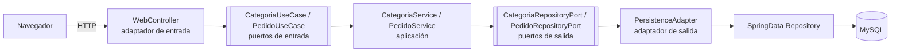

# Arquitectura hexagonal del proyecto

El **dominio** (modelos y puertos) no conoce a Spring ni a JPA. Los **adaptadores** conectan el mundo exterior (web, MySQL) con esos puertos.

## Recorrido de una solicitud: `GET /pedidos`

1. El navegador envía `GET /pedidos`. **Spring Security** verifica la sesión; si no hay, redirige a `/login`.
2. `WebController.pedidos()` llama a `PedidoUseCase.listarPedidosPorEstado(estado)`.
3. `PedidoService` (implementa el puerto de entrada) delega en `PedidoRepositoryPort`.
4. `PedidoPersistenceAdapter` (implementa el puerto de salida) llama a `SpringDataPedidoRepository`.
5. Hibernate ejecuta el `SELECT` sobre la tabla `pedido` en **MySQL**.
6. Las filas vuelven como `PedidoEntity`, el adaptador las convierte a `Pedido` (dominio) y regresan por el servicio al controlador.
7. El controlador pone la lista en el `Model` (`pedidos`) y devuelve la vista `pedidos`; **Thymeleaf** genera el HTML con `th:each`.

## Reglas respetadas

- El controlador **no** contiene lógica de persistencia: solo llama a casos de uso.
- El dominio es Java puro; las entidades JPA viven en `infrastructure`.
- Cambiar MySQL por otra fuente solo exige un nuevo adaptador de salida.
